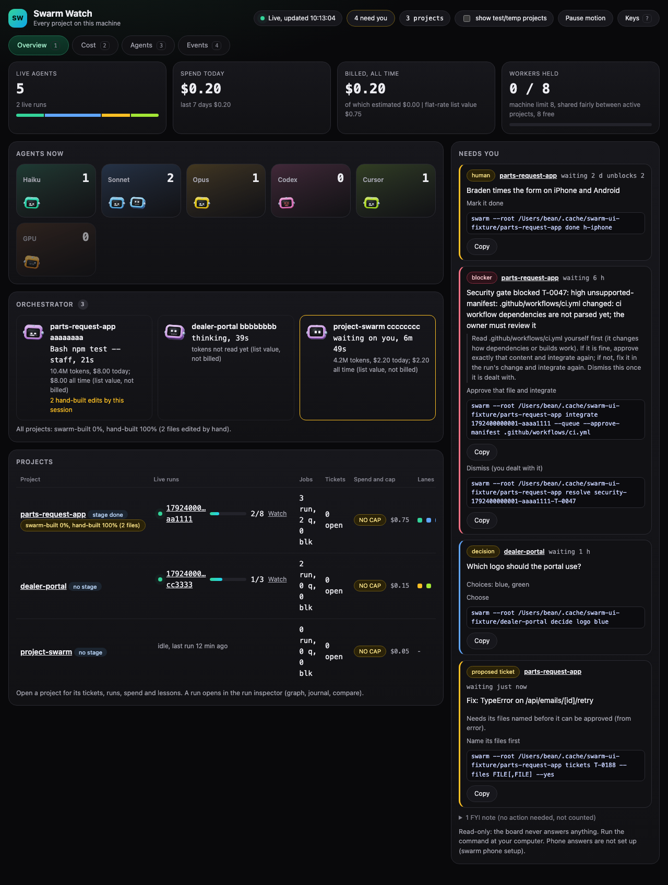

# The Orchestrator lane

Swarm Watch shows the Claude Code sessions that drive a project as their own lane, next to the swarm's workers: one robot head per active session, labelled by project, with what it is doing now, how long, its tokens and list cost, and how much of the project it built by hand.

## What is captured

A hook runs on four Claude Code events (`PreToolUse`, `PostToolUse`, `Stop`, `UserPromptSubmit`) and appends one small line to `<project>/.swarm/orchestrator/events.ndjson`:

| Field | Meaning |
|---|---|
| `at`, `s`, `e` | time, session id, event (`pre`, `post`, `stop`, `prompt`) |
| `t` | the tool name (`Edit`, `Bash`, `Read`, ...) |
| `f` | a file path **inside the project**, relative (never contents) |
| `c` | for a shell command, its first 80 characters with keys, tokens, `NAME=value` assignments and long opaque strings masked |
| `hb` | 1 when an edit landed outside `.swarm/` and `docs/plans/` (a hand-built edit) |
| `err`, `out` | the tool reported an error; the path was outside the project (the path itself is not stored) |
| `u` | the tool call's id, so tools running at once are tracked one by one |
| `tp` | the session transcript's **file name** only (on prompt and stop events); the folder is found again under `~/.claude` when the board reads it |

Never stored: file contents, edit strings, prompt text, tool output, paths outside the project (a path that reaches outside through a symlink counts as outside). A shell command is masked for keys, tokens, `NAME=value`, secret-named flags (`--api-key X`), `-p`/`-u user:pw`, URL credentials and header values before it is stored. The hook refuses to write through a symlink at `.swarm`, `.swarm/orchestrator` or the log. Sessions that run inside a swarm worker workspace are ignored (they are workers). The file is rotated at 1.5 MB. The hook prints nothing and always exits 0, so it can never hold up or change a tool call.

Tokens and cost are read from the session's own transcript (the path the hooks record), once per message and then only what was appended. A subscription session costs nothing extra: the dollars shown are **list value** (what the same tokens would cost at list price), marked so on every page, shown on the Cost tab and the project, and **never added to billed spend**. A model without a known rate is counted in tokens and not priced.

## What the board shows

- **Overview, Orchestrator card:** a head per session. Working (a tool is running), thinking (a prompt or tool result is being worked on), waiting on you (the turn ended), idle. The line under the name is the current tool and file or command (for example `Edit src/a.tsx, 12s`) and how long it has run.
- **Cost tab:** a tile for the list value today and all time, and a table of sessions with tokens, list value today and all time, and hand-built edits.
- **Project cards and rows:** `swarm-built 83%, hand-built 17% (12 files)`: the share of the project's files (distinct files) written by the swarm's finished jobs against files an orchestrator edited by hand.
- **Project Live tab and run pages:** the same heads, so everything working on a project is in one place.

Hand-built means an `Edit`, `Write`, `MultiEdit` or `NotebookEdit` outside `.swarm/` and `docs/plans/`. Writing tickets and plans is the orchestrator's job and never counts. Shell writes (`sed -i`, `>`, `tee`) are not seen by this lane; the hand-build guard (a separate step) handles them.

## Installing and removing it

`swarm init` and `swarm update` put the hooks in the project's **`.claude/settings.local.json`** (the personal file Claude Code reads, which is git-ignored), next to the existing checkpoint hook; they are never pushed onto collaborators who do not run swarm. The command points at the install's `current` folder, so it keeps working after an update; an entry from an older install is replaced, any other hook or setting is kept, and a settings file that is not valid JSON is left alone and reported. `swarm update` refreshes the hooks only in projects that were set up with agent files (they already have the checkpoint hook or these hooks); it never adds them to a project without. To switch the lane off in a project, create the empty file `.swarm/orchestrator/off`: nothing is installed or refreshed there. To remove the hooks, delete the four entries whose command names `orchestrator-hook.mjs`.

The transcript reader opens only files whose real path is under Claude Code's own folder (`~/.claude`), and counts each message once even when a session appears in two projects or was resumed.
