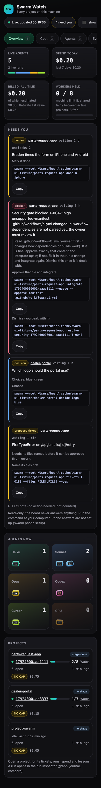

# Swarm Watch on your phone (`swarm remote`)

See the `swarm watch --all` board on your phone, over Tailscale. Your own devices only: never the public internet.

Think of it as a private door that only your phone has the key to. Tailscale is the hallway that only your devices can walk down. The token in the link is the key.

## Turn it on

```
swarm remote on
```

It checks, in order:

1. Tailscale is installed (if not, it tells you how: `brew install --cask tailscale`, or download it from https://tailscale.com/download) and signed in (if not, it runs `tailscale up` and shows you the sign-in address).
2. Funnel (Tailscale's public-internet feature) is **off** for the board's port. If it is on, `swarm remote on` refuses and starts nothing.
3. It starts the board on **127.0.0.1 only** (a port that only this computer can reach) with a token that is saved once and stays the same until you rotate it.
4. It runs `tailscale serve` so your tailnet reaches that port over HTTPS (`https://YOUR-COMPUTER.YOUR-TAILNET.ts.net:8443`). It uses port 8443 so anything you already serve on the normal port is left alone.
5. It checks its own work: Tailscale's settings show your entry and Funnel still off (foreground Funnel and Funnel on another entry that points at the board count too); this computer resolves the name to tailnet addresses only (100.64.0.0/10); a request without your Tailscale login is refused; the board answers over the tailnet; a wrong token is refused. If Funnel is on, or Tailscale's answer is unclear, it takes everything down again. (The name check uses this computer's own resolver, which always answers with tailnet addresses, so it cannot show how the internet sees the name. That is why Funnel is read from Tailscale's settings.)
6. It prints the address with the token, a QR code of it, and the phone steps.

Example of what you see at the end (invented address and token):

```
█████████████████████████████████████████████
██ ▄▄▄▄▄ ██ █ ▄▄███ █▄▀ ▄▄  ▀▀▄█▀▄██ ▄▄▄▄▄ ██
██ █   █ █ ▀▄▀ █▀█▀▄▄█▄ ▄█▄▄▀▀▀█▀▄▄█ █   █ ██
██ █▄▄▄█ █  █▄▄▀ ▄▀ ▄▄ ▀ ▄▄▀█▀█▄█▄▀█ █▄▄▄█ ██
██▄▄▄▄▄▄▄█ ▀▄█▄▀ ▀ █ █▄▀▄█▄█ ▀▄█▄▀▄█▄▄▄▄▄▄▄██
██▄█▄▄▄▄▄██▀ ▄ █▀██▄█▀█▀▀▀▄▄█▄▀ █▀▀█ ▄ ▄ ▀▀██
███ █  █▄█   ▄▀█▄▄ ▄ █▀▀▄█▀█▀ ▄▄█▀ ▀██▀▀█████
██▀   ▄ ▄▀▀ ▀█▄▀██▀▄▀█▄▀▀▄▄▄▀ ▄▄▄▄▀▀▀▄▀    ██
██  ▀▀ █▄▀▀▀▄▄  █▄ ▄▀█▄ ▀ ▄▄▀ ▄▄█ ▀▄▀██▀▄████
██▀▄ ▄▄█▄█▄▀ █ ▀▄  ▄▄▀▄█▀ ▀▄▄▄▀ ▄ ▄▄▀ ▀▀▄▀▀██
██ ▀█ █ ▄▄▄█  ▄▄ ▀▄█▄█▀█▄▀▄█▀ ▄ ▀█  ▄█ █▄▀▀██
██▄ ▄▀█▀▄ ▀▀▀▄▄▀▀█▀█▄▀▀ ▄▀▀▀▀▄▄▀▀▀▄▄▀▀▀▄▄▀ ██
███▀▄ ▀▀▄▄ ▀▄▄▄ █ ██▀█▄ ▀█▄▄▄  █▄█▀▄▀▄▀ ██▀██
██ ▀█▄█ ▄▄▀▀▄▀█▀ ▀█▄█ ▄▀▀▀▄▄ █▀  ▀█▄▀▄▀▀▄█▀██
███▄▀▀▀ ▄ ▄▀█▄▄ ▀▀█▄▄▀▄▀ █▀▄█  ▄█▀ ██▄ ▀█ ███
██ ▄ ▀▄▄▄▄ ▀███▀▀█▀▄▀█▀▀▀█▀▄▀▀▀ █▄█▀▀▄▀ ▄  ██
██ █▄   ▄▀▀ ▄▀██▄▄ ▄█ ▀▀██▀█▄█▀█ ▀▀  ▀  █▀███
██▄██▄██▄▄ ▄▀█▄ ▄▄▀ ▄ ▄▀▀▀▄ ▄█▀▄▄▀ ▄▄▄ ▄▄▀▀██
██ ▄▄▄▄▄ █▀  █   ▄▀ ▀▀▄ ▀██ ▄ ▄█▄▄ █▄█ ██▄▀██
██ █   █ █ █ ▀█▄▄ ▄█▀▀▄ ▀▀▀█▄█▄▀▄█▄ ▄ ▄▄▄▄███
██ █▄▄▄█ █▄█▀▄ ▀▄▀█▄▄██▀█▀▀█▄ ▀██ ▀▄▄▄ ▀▄▀███
██▄▄▄▄▄▄▄█▄██▄▄▄▄▄█▄▄▄▄███▄▄▄▄█▄███▄█▄▄█▄████
█████████████████████████████████████████████
```

## On your phone

1. Install the **Tailscale** app and sign in with the **same account** as this computer. Switch it on.
2. Point the camera at the QR code, or type the address into the browser.
3. The board opens, read-only. Add it to the Home Screen if you like. It is the same board as on the computer: one column on a phone, Needs you first.



(The screenshot is the board at phone width with invented data. Screenshots of the Tailscale app itself are not included: they need a real phone and a real tailnet, which this page was written without.)

## What is and is not reachable

- Read-only. The board only answers GET requests. Nothing on it starts, stops, approves or merges anything.
- Answers still go the way they do today: through the swarm-inbox issues (`swarm phone`, `docs/phone-approvals.md`), not through this board.
- Two locks: every request must come through Tailscale as the login this computer uses (Tailscale puts that login on what it proxies; a Funnel request has none), **and** the link must carry the token. The login is checked first and whatever the Host header says, so a request that pretends to be local gets nothing. Every refusal is the same "forbidden", so the board's port cannot be probed for.
- The per-run live page (`swarm watch RUN`) starts a small server on this computer for each run, so it is not offered remotely. The board's own run inspector (`/run`) is.
- It does not survive a reboot of this computer: run `swarm remote on` again (the token stays the same).

## The other commands

| Command | What it does |
|---|---|
| `swarm remote status` | Is it on, is the board up, is the Tailscale entry there, is Funnel off. Does not print the token. |
| `swarm remote show` | Prints the address with the token and the QR code again. |
| `swarm remote rotate` | A new token. The old link stops working at once. Use it if a link was shared by mistake. |
| `swarm remote off` | Removes the Tailscale entry (only if it is ours), stops the board, deletes the token. |

## What this never does

- Never runs `tailscale funnel` (the code does not contain that call; a test checks it) and never turns it on. If Funnel is on for the board's address, `on` refuses and `status` says so. If it appears after setup, the board refuses every request (they carry no login) and stops itself within 30 seconds; `swarm remote status` then says so and `swarm remote off` removes the entry.
- Never listens on a network address: the board binds `127.0.0.1`. Only `tailscale serve` connects to it.
- Never changes something else you serve with Tailscale: if the board's port is already used by something that is not ours, it stops and says so.

## If something goes wrong

- **"Serve is not enabled" or an HTTPS error:** open https://login.tailscale.com/admin/dns, turn on MagicDNS and HTTPS certificates, and approve Serve when Tailscale asks. Run `swarm remote on` again. Nothing is left running after a failure.
- **"Funnel is ON":** run `tailscale funnel --https=8443 off` yourself, then `swarm remote on`. (swarm will not run a funnel command, not even to turn it off.)
- **The page says forbidden:** the link is missing the token or it was rotated. Use `swarm remote show`.
- **The page does not open:** the phone's Tailscale app is off, or signed in to a different account.
- **The board stopped** (computer restarted): `swarm remote status` says so; `swarm remote on` starts it again.

## How it was tested

The tests (`tests/remote.test.mjs`) run the whole flow against a pretend `tailscale` command (`tests/fixtures/mock-tailscale.mjs`): Funnel is never called, Funnel on (also foreground, or on another entry that points at the board) refuses, Funnel appearing during setup tears everything down, Funnel appearing later stops the board, an unreadable Tailscale answer is never taken for "nothing is set", a public name tears everything down, a board that starts late is stopped, off removes everything and keeps the settings (and says so) when it cannot, rotate replaces the token and the old one stops working, a request with another login, no login, a faked loopback Host or a Funnel header is turned away. The QR code encoder is checked against the textbook Reed-Solomon vector and, when written, by decoding its output with macOS's own QR reader.

Not tested yet: a real Tailscale on a real network, and a real phone. The first real `swarm remote on` is that test.
